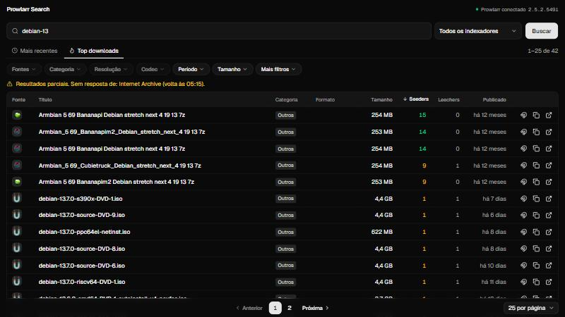

# TorFaro

**Todos os seus indexadores do [Prowlarr](https://prowlarr.com) em uma única tela de busca.** Compare resultados, filtre por qualidade e abra direto no seu cliente de torrent, sem anúncios, sem abrir vários sites e com a API key protegida no servidor.

O nome junta *torrent* e *faro*, o talento para achar as coisas. Não tem relação com a rede Tor.

[](https://github.com/Hirokyn/TorFaro/actions/workflows/ci.yml)
[](LICENSE)




> **English summary:** all your Prowlarr indexers in one search screen. TorFaro is a self-hosted front end for your existing Prowlarr instance. It adds checkbox filters, *Recent* and *Top* tabs, a detail page per result and one-click magnet links, while keeping the Prowlarr API key on the server. The interface is in Brazilian Portuguese. Quick start: copy `.env.example` to `.env`, set `PROWLARR_URL` and `PROWLARR_API_KEY`, then run `docker compose up -d --build`. It has **no login**, so keep it off the public internet.

## Para que serve

O Prowlarr é ótimo para gerenciar indexadores e abastecer Sonarr e Radarr, mas a busca manual dele não foi pensada para o dia a dia. Este projeto é um **integrador**: fica entre você e um Prowlarr que já funciona, e entrega uma experiência de site de busca, sem substituir nada.

- **Não altera o Prowlarr.** Só lê dados pela API.
- **Não acessa os sites de torrent.** Toda consulta passa pelo Prowlarr.
- **Não hospeda nada.** Não tem banco de dados nem guarda conteúdo.

## Recursos

- Busca simultânea em todos os indexadores, ou só nos que você escolher
- Guias **Mais recentes** e **Top downloads**, sem precisar digitar nada
- Filtros com caixas de seleção por fonte, categoria, resolução, codec, período e tamanho
- Filtros por seeders e por palavras no título, incluindo as que devem ficar de fora
- Ordenação por qualquer coluna e paginação instantânea, sem repetir a consulta
- Página de detalhes com trackers, infohash e, quando a fonte permite, a lista de arquivos
- Botão de ímã que abre o seu cliente de torrent, como nos sites comuns
- Agrupamento de duplicados pelo infohash
- Uma fonte lenta nunca derruba a busca: as demais aparecem normalmente
- Links compartilháveis com termo e filtros, layout para celular e tema claro ou escuro automático

## Requisitos

| Item | Necessário |
| --- | --- |
| Prowlarr | Instância em funcionamento, com ao menos um indexador de torrent. Testado na versão 2.5 |
| Docker | Docker e Docker Compose (recomendado) |
| Sem Docker | Node.js 24 e npm |
| Rede | O servidor da aplicação precisa alcançar o Prowlarr |
| Cliente de torrent | Instalado no aparelho de quem usa, para abrir os links magnet |

## Instalação rápida

```bash
git clone https://github.com/Hirokyn/TorFaro.git
```

```bash
cd TorFaro
```

```bash
cp .env.example .env
```

Edite o `.env` com o endereço do Prowlarr e a API key, que fica em **Settings > General**:

```env
PROWLARR_URL=http://192.0.2.10:9696
PROWLARR_API_KEY=sua-chave-aqui
```

Suba a aplicação:

```bash
docker compose up -d --build
```

Acesse <http://localhost:3000>. O ponto verde no canto da tela indica que o Prowlarr foi encontrado.

> **Importante:** a aplicação não tem login e, por padrão, só atende a própria máquina. Antes de abrir para a rede, leia [Acesso pela rede](docs/MANUAL.md#acesso-pela-rede).

## Documentação

- **[Manual completo](docs/MANUAL.md):** a ideia do projeto, instalação, uso, segurança, personalização e solução de problemas
- **[API](docs/API.md):** rotas internas e contratos
- **[Histórico de versões](CHANGELOG.md):** o que mudou em cada versão
- **[Acessibilidade](ACCESSIBILITY.md):** o que já existe e os limites conhecidos

## Segurança

- A API key do Prowlarr nunca chega ao navegador. Os links de download ficam no servidor, trocados por tokens temporários.
- **Não há autenticação.** Quem alcança o endereço usa a aplicação. Mantenha-a na rede local ou atrás de VPN ou de um proxy com login.
- Encontrou uma falha? Siga a [política de segurança](SECURITY.md).

## Aviso legal

Este projeto é apenas uma interface para uma instância do Prowlarr que você já opera. Ele não hospeda, indexa nem distribui conteúdo, e não é afiliado ao Prowlarr nem a nenhum site de torrent. Você é responsável pelas fontes que configura e pelo que baixa. Use somente para conteúdo que tenha direito de acessar, respeitando as leis do seu país.

## Contribuindo

Sugestões e correções são bem-vindas. Leia o [guia de contribuição](CONTRIBUTING.md) e o [código de conduta](CODE_OF_CONDUCT.md).

## Licença

[MIT](LICENSE)
